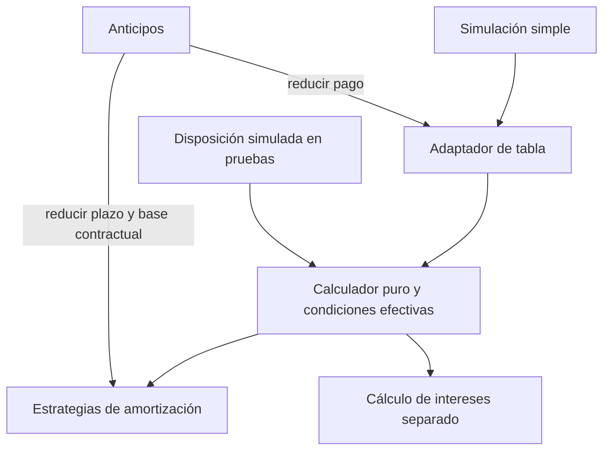

# ADR 0034: amortización reutilizable de los métodos actuales

- Estado: aceptado; implementación integrada en main mediante PR #62 (`15bdc8d`).
- Fecha: 2026-10-31.
- Complementa [ADR 0032](adr-0032-core-crediticio-extensible.md), [ADR 0033](adr-0033-convenciones-dias-base-fija.md) y ADR 0023.

## Contexto

Tabla y anticipos deciden entre cuota nivelada y capital fijo. Las futuras
disposiciones necesitan las mismas estrategias sin depender de Eloquent ni de
una estructura financiera concreta. El motor histórico calcula interés con
órdenes de operaciones distintos en tabla y reducción de plazo; homogeneizarlos
cambiaría evidencia contractual.

## Decisión

Separar `EstrategiaAmortizacion` y las estrategias sin estado `CuotaNivelada` y
`CapitalFijo`. Preparan la base, obtienen capital por periodo y recuperan una base
contractual desde capital/interés, sin incluir impuestos ni comisiones.
`CalculadorAmortizacion` recibe `CondicionesAmortizacion` inmutables y devuelve
`ResultadoAmortizacion` con `BaseAmortizacion`. Las filas conservan arrays tipados
por PHPDoc; no se reescribe el estado completo de pagos por estilo.

El calculador recibe fechas ya definidas; `InteresPorPeriodo` conserva el cálculo
Act/360 actual. El llamador aporta capital insoluto: esto no habilita Flat ni
otra política de base. La estrategia no determina exigibilidad ni registra pagos.
El cierre del calendario completo liquida el residuo; la reducción de plazo
conserva base y limita capital al saldo sin extender el calendario. Las guardas
positivas siguen limitadas a los métodos actuales, sin definir reglas Bullet.

`TablaAmortizacionCreditoSimple` adapta argumentos/salida existentes y traduce
`AmortizacionInvalida` a validación española en `metodo`. Valida compatibilidad
motor/convención antes del cálculo. Los anticipos comparten las estrategias,
conservando su orquestación, errores en `pago`, fórmulas históricas, impuestos y
comisiones. La reducción de pago sigue usando el adaptador de tabla.

## Consecuencias y límites

No hay nuevo algoritmo, formato persistido, tabla, endpoint, variable o selector.
Motor 1 continúa reproduciendo sus límites y motor 2 sus correcciones. Snapshots,
hashes, contratos y productos anteriores no se reescriben. Autorización,
contexto, bloqueos, previas, idempotencia y eventos permanecen en aplicación.
No se agregan eventos por cálculo interno.

El ejemplo ejecutable sin Laravel demuestra resultados independientes, igualdad
simple/disposición y llamadas intercaladas con métodos distintos. Las disposiciones
son escenarios de prueba, no una línea operativa ni aceptación de sus reglas.

El catálogo backend/Vue, obligaciones independientes, recepción/conciliación,
Bullet, Revolvente y Nómina continúan pendientes. Solo Act/360 está habilitada.
Las reglas futuras necesitan casos y compatibilidad propios.

## Evidencia

[Contrato canónico](../reference/core-crediticio.md#amortización-reutilizable),
[Agent Note](../agent-notes/core-crediticio-extensible.md).
Pruebas: `AmortizacionReutilizableTest`, `AnticiposCaracterizacionTest`,
`IntegridadMotorCreditoTest`, `MotorAnticiposTest`, `CreditoAnticiposTest` y
`VersionMotorCreditoTest`. Fixtures sintéticos capturan tablas y resultados de
anticipos del código base `56026d0`; no son un diagnóstico de cartera real.
