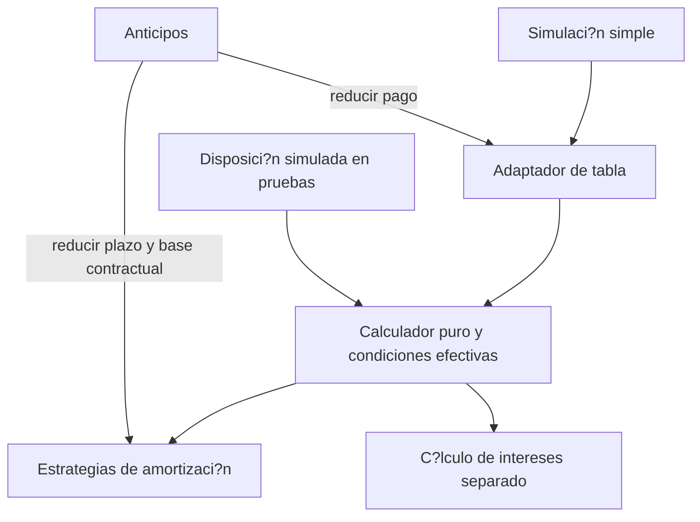

# ADR 0034: amortizaci?n reutilizable de los m?todos actuales

- Estado: aceptado; implementaci?n en rama, pendiente de integraci?n.
- Fecha: 2026-10-31.
- Complementa [ADR 0032](adr-0032-core-crediticio-extensible.md), [ADR 0033](adr-0033-convenciones-dias-base-fija.md) y ADR 0023.

## Contexto

Tabla y anticipos deciden entre cuota nivelada y capital fijo. Las futuras
disposiciones necesitan las mismas estrategias sin depender de Eloquent ni de
una estructura financiera concreta. El motor hist?rico calcula inter?s con
?rdenes de operaciones distintos en tabla y reducci?n de plazo; homogeneizarlos
cambiar?a evidencia contractual.

## Decisi?n

Separar `EstrategiaAmortizacion` y las estrategias sin estado `CuotaNivelada` y
`CapitalFijo`. Preparan la base, obtienen capital por periodo y recuperan una base
contractual desde capital/inter?s, sin incluir impuestos ni comisiones.
`CalculadorAmortizacion` recibe `CondicionesAmortizacion` inmutables y devuelve
`ResultadoAmortizacion` con `BaseAmortizacion`. Las filas conservan arrays tipados
por PHPDoc; no se reescribe el estado completo de pagos por estilo.

El calculador recibe fechas ya definidas; `InteresPorPeriodo` conserva el c?lculo
Act/360 actual. El llamador aporta capital insoluto: esto no habilita Flat ni
otra pol?tica de base. La estrategia no determina exigibilidad ni registra pagos.
El cierre del calendario completo liquida el residuo; la reducci?n de plazo
conserva base y limita capital al saldo sin extender el calendario. Las guardas
positivas siguen limitadas a los m?todos actuales, sin definir reglas Bullet.

`TablaAmortizacionCreditoSimple` adapta argumentos/salida existentes y traduce
`AmortizacionInvalida` a validaci?n espa?ola en `metodo`. Valida compatibilidad
motor/convenci?n antes del c?lculo. Los anticipos comparten las estrategias,
conservando su orquestaci?n, errores en `pago`, f?rmulas hist?ricas, impuestos y
comisiones. La reducci?n de pago sigue usando el adaptador de tabla.

## Consecuencias y l?mites

No hay nuevo algoritmo, formato persistido, tabla, endpoint, variable o selector.
Motor 1 contin?a reproduciendo sus l?mites y motor 2 sus correcciones. Snapshots,
hashes, contratos y productos anteriores no se reescriben. Autorizaci?n,
contexto, bloqueos, previas, idempotencia y eventos permanecen en aplicaci?n.
No se agregan eventos por c?lculo interno.

El ejemplo ejecutable sin Laravel demuestra resultados independientes, igualdad
simple/disposici?n y llamadas intercaladas con m?todos distintos. Las disposiciones
son escenarios de prueba, no una l?nea operativa ni aceptaci?n de sus reglas.

El cat?logo backend/Vue, obligaciones independientes, recepci?n/conciliaci?n,
Bullet, Revolvente y N?mina contin?an pendientes. Solo Act/360 est? habilitada.
Las reglas futuras necesitan casos y compatibilidad propios.

## Evidencia

[Contrato can?nico](../reference/core-crediticio.md#amortizaci?n-reutilizable),
[Agent Note](../agent-notes/core-crediticio-extensible.md).
Pruebas: `AmortizacionReutilizableTest`, `AnticiposCaracterizacionTest`,
`IntegridadMotorCreditoTest`, `MotorAnticiposTest`, `CreditoAnticiposTest` y
`VersionMotorCreditoTest`. Fixtures sint?ticos capturan tablas y resultados de
anticipos del c?digo base `56026d0`; no son un diagn?stico de cartera real.
