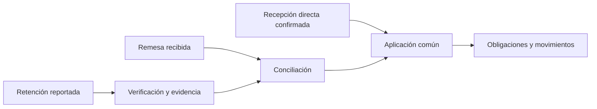

# Core crediticio: responsabilidades y contratos de evolución

Dirección aprobada el 29/10/2026: [ADR 0032](../explanation/adr-0032-core-crediticio-extensible.md).
El [roadmap de Notion](https://app.notion.com/p/40961db7db7f819a8af1d7c3cfec2df7)
conserva alcance, dependencias y fechas. Esta referencia no acredita nuevas
capacidades implementadas. Estado de base: main `9106a6e`; primer incremento de
integridad implementado localmente en `feat/core-crediticio-extensible`, todavía
sin integración ni despliegue acreditados.

## Implementación actual y objetivo

| Responsabilidad | Base actual | Regla de evolución aprobada |
| --- | --- | --- |
| Producto/condiciones | Versiones y snapshots conservados | Congelar condiciones efectivas, capacidades y versión del motor |
| Estructura financiera | Crédito simple y desembolso único | Simple y línea revolvente; saldo global o por disposición |
| Amortización | Cuota nivelada y capital fijo | Estrategias reutilizables; Bullet con capital intermedio cero |
| Intereses | Motor histórico y motor 2 con acumulación de numeradores Act/360 | Extender políticas independientemente de frecuencia de pago |
| Exigibilidad | Cargos fechados y atraso de capital | Obligaciones diferenciadas; intereses pueden vencer antes del capital |
| Clasificación comercial | Catálogo de productos | Nómina no impone otra fórmula ni otro configurador |
| Cobranza/recepción | Registro manual QA junto a aplicación | Retenciones, remesas, recepción y aplicación distinguibles |
| Consultas | Estado calculado desde evidencia cifrada | Proyecciones relacionales reconstruibles y fechadas |
| Auditoría | Emisores y cobertura parcial documentados | Mantener matriz, contexto original y pruebas por entrega |

## Invariantes y límites de integración

- Importes y tasas viajan como decimales. El backend calcula resultados; la UI no
  recalcula intereses ni distribuciones de pago.
- La amortización distribuye principal; el interés define su costo; la exigibilidad
  determina cuándo se debe pagar. Ninguna dimensión sustituye a otra.
- Cuota base y total con impuestos/cargos no son equivalentes. Comisiones y
  fiscalidad permanecen por concepto; no inferir exención o IVA universal.
- El CAT es una estrategia separada y conserva sus supuestos específicos;
  días reales para devengo no implican reemplazar el CAT por una TIR de fechas.
- Una operación conserva previo, resultado, versión de cálculo, fecha efectiva,
  fecha de captura, actor y contexto. Las proyecciones no modifican esa evidencia.
- Consultar no registra devengos. Si se añaden avances/cortes programados, su
  idempotencia y contabilización deben impedir cobrar o registrar dos veces.
- Activar un producto nuevo no cambia contratos existentes. No usar condiciones
  comerciales actuales para reconstruir su historia.
- Los componentes puros no emiten eventos de auditoría. Aplicación conserva los
  eventos de negocio una vez por operación, también ante reintentos.

## Reutilización exigida

Una estrategia amortiza tanto un simple como una disposición con condiciones
equivalentes. Una línea puede contener disposición A nivelada y B Bullet si el
producto lo habilita; no se devenga simultáneamente sobre la línea y otra vez
sobre sus disposiciones. Las dos operativas revolventes comparten primitivas,
no necesariamente reglas de mínimo, calendario o distribución.

La disponibilidad distingue límite, principal comprometido y reservas aplicables.
Pagar intereses no devuelve capital al cupo. Revertir un pago que permitió otra
disposición requiere revisar dependencias de toda la línea; la restricción actual
de último pago de un simple no demuestra que esa corrección sea admisible.

## Recepción, Nómina y conciliación

Las flechas representan responsabilidades propuestas, no módulos implementados.
El efecto contractual de una retención antes de recibir dinero debe definirse
explícitamente. «En tránsito» es estado operativo, no medio de recepción ni caja.
Separar calendario del trabajador, plazo de remesa y gracia del trabajador.

En una remesa: recibido = asignado + pendiente de asignar; impedir sobreasignación,
duplicación y aplicación dos veces al llegar dinero ya conciliado. La coexistencia
posterior de pagos directos exige resolver retención pendiente/remesa posterior y
excedentes con reglas aprobadas.

## Contratos históricos y versión de motor

`VersionMotorCredito` distingue algoritmo de formato. `motor_calculo_version` se
congela en snapshots nuevos de producto y se conserva en simulación y cronogramas
generados por anticipos. `MotorPagos::iniciar` rechaza producto/calendario de
versiones diferentes. Una marca desconocida o nula explícita se rechaza en español.

| Evidencia | Algoritmo |
| --- | --- |
| Snapshot histórico sin marca | 1: reproducción del algoritmo anterior, incluidos sus límites conocidos |
| Snapshot con marca 1 | Algoritmo histórico |
| Borrador sin snapshot | Simulación con motor actual 2 |
| Nueva activación o programación | Congela motor 2; no actualiza versiones anteriores |

El motor 2 conserva el numerador `capital × tasa_porcentual × días` y divide entre
36000 después de acumular. Tabla, devengo y anticipos comparten `InteresAct360`.
Los campos de numerador del estado no son cantidades cobradas: permiten conservar
precisión entre consultas/pagos. Si se pierde un acumulador ya usado, el motor
rechaza avanzar; no lo inventa multiplicando un interés truncado.

En los dos métodos actuales, el motor 2 rechaza calendarios no crecientes,
principal inferior a un centavo y amortizaciones no positivas o superiores al
saldo. Esta guarda pertenece a los métodos actuales; no es una prohibición global
de capital cero para Bullet. Los mensajes se devuelven en `metodo` en español.

La ausencia de marca no se escribe sobre registros inmutables. No se recalcula
historia. Para originar con las correcciones de un producto histórico se debe
crear/activar una nueva versión; simular el anterior reproduce el motor 1. La
cartera previa puede conservar diferencias F-01/F-02: su diagnóstico y tratamiento
siguen pendientes, no quedan corregidos por desplegar este código. No cambiar
marcas, saldos o recibos manualmente para migrarla. Revisar compatibilidad del
código antes de retroceder una aplicación que ya conserve estados del motor 2.

Se conservan las restricciones vigentes de referencia reservada, fechas pasadas,
reverso y gracia. Su ampliación necesita decisión funcional y pruebas propias.

## Definiciones pendientes antes de operación

| Capacidad | Definición necesaria |
| --- | --- |
| Bullet | Primera fecha, duración, periodos incompletos, anticipos/parcialidad, interés vencido, mora y liquidación |
| Revolvente | Mínimo, disponibilidad, reservas, distribución, corte/fecha límite y límites por disposición |
| Nómina | Reconocimiento entre descuento/recepción, remesa parcial/no recibida, reversos y bajas |
| Escalabilidad | Medición en entorno identificado con 10 mil créditos/líneas activos y disposiciones asociadas |

No elegir valores ni efectos pendientes por conveniencia de implementación.
Los ejemplos PDF son referencias de flujo, no resultados matemáticos obligatorios.

## Pruebas de aceptación de arquitectura

- Casos independientes de centavos, conservación de capital, tasas/plazos extremos,
  fin de mes y bisiestos; avance total frente a avance por intervalos.
- Equivalencia entre simple y disposición con condiciones iguales; combinación de
  estrategias autorizadas en disposiciones distintas.
- Pagos, anticipos, liquidación y reversos con conceptos/impuestos separados.
- Concurrencia multiconexión sobre MariaDB aislada; SQLite o secuencias de previas
  no acreditan contención simultánea.
- Reconstrucción de proyecciones, compatibilidad histórica, permisos/sucursales,
  Super Admin y auditoría sin metadatos sensibles.
- E2E y revisión escritorio/móvil por capacidad; métricas de consulta, memoria y
  tiempos con distribución de datos y hardware identificados, sin SLA inventado.

Relacionadas: [productos](productos-crediticios.md), [auditoría](auditoria-eventos.md),
[contraste de auditoría](../explanation/contraste-auditoria-core-crediticio-2026-10.md).
